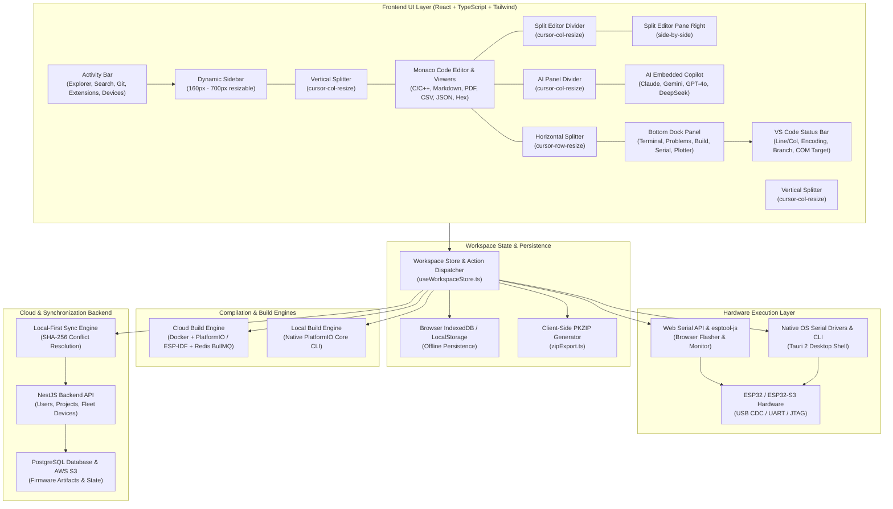
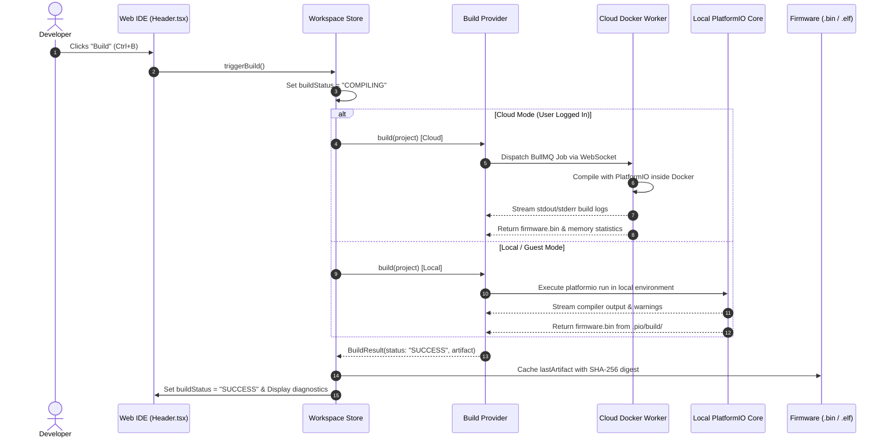
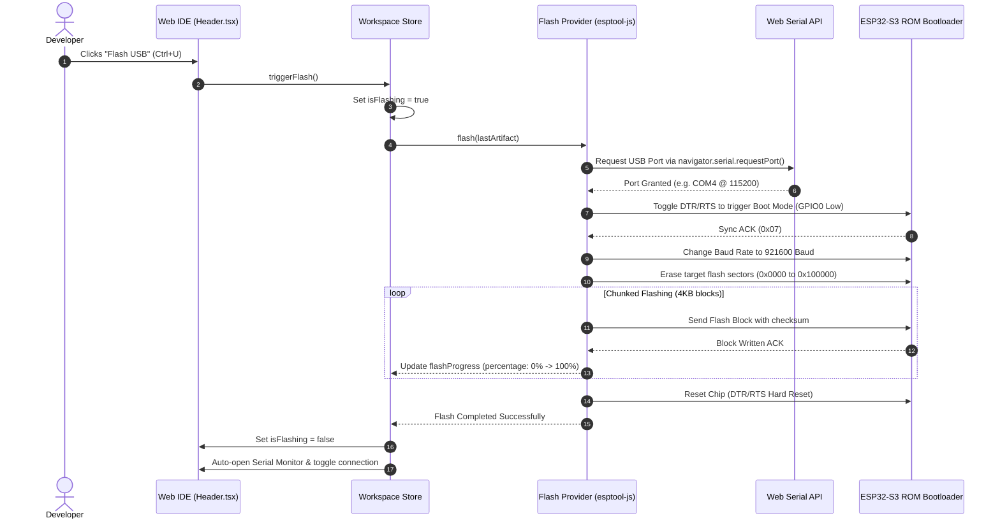
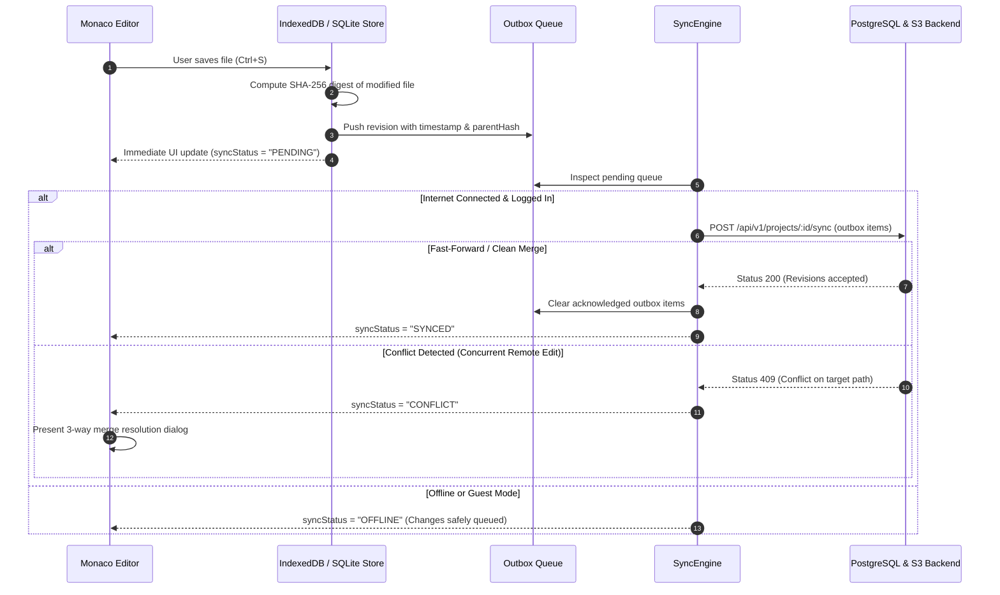

# ESP Studio — Architecture & Developer Guide

This document provides a comprehensive technical architecture overview, complete file/folder structural breakdown, component hierarchy, execution flows, and step-by-step developer guides for extending **ESP Studio**.

---

## 📐 1. System Architecture Diagram

ESP Studio is designed as a **hybrid embedded development platform** based on a "one codebase, one project format, two execution environments" paradigm.



---

## 🗂️ 2. Complete Folder & File Structure

```
esp-studio/
├── .gitignore                          # Git ignore rules for node, dist, and pio artifacts
├── package.json                        # Root monorepo workspace manifest
├── pnpm-workspace.yaml                 # Monorepo workspaces definition
├── tsconfig.json                       # Root TypeScript project references configuration
├── start.bat                           # 1-Click Windows development launcher
├── start.ps1                           # 1-Click PowerShell development launcher
├── start.sh                            # 1-Click Bash development launcher (Linux & macOS)
├── esp-studio-starter.zip              # Pre-packaged, redistributable project archive
├── README.md                           # Master project documentation
├── ARCHITECTURE.md                     # Comprehensive architecture and developer guide
│
├── apps/
│   ├── web/                            # React + TypeScript + Vite web workspace
│   │   ├── index.html                  # HTML entry point with Monaco AMD loader
│   │   ├── package.json                # Web app dependencies (React, Vite, Lucide)
│   │   ├── tsconfig.json               # Web TypeScript configuration
│   │   ├── vite.config.ts              # Vite bundling configuration
│   │   └── src/
│   │       ├── main.tsx                # React DOM root entry point
│   │       ├── App.tsx                 # Main layout with stretchable/resizable sections
│   │       ├── themeTokens.ts          # VS Code Dark, GitHub Dark, Monokai, Nord themes
│   │       │
│   │       ├── components/             # User Interface Components
│   │       │   ├── Header.tsx          # Top navigation, board target selector, build/flash buttons
│   │       │   ├── TopMenuBar.tsx      # VS Code application menu bar (File, Edit, Selection, View...)
│   │       │   ├── ActivityBar.tsx     # Leftmost vertical VS Code icon rail
│   │       │   ├── ExplorerSidebar.tsx # Nested expandable tree, open editors, file operations
│   │       │   ├── SearchSidebar.tsx   # Workspace-wide find and replace
│   │       │   ├── SourceControlSidebar.tsx # Git staged/unstaged changes, commit, branch switcher
│   │       │   ├── EditorGroup.tsx     # Editor tabs, breadcrumbs, split controls, format action
│   │       │   ├── MonacoEditor.tsx    # Microsoft Monaco Editor with syntax coloring & diagnostics
│   │       │   ├── ProblemsPanel.tsx   # Compiler diagnostics and problem markers
│   │       │   ├── StatusBar.tsx       # Bottom status bar (Line, Col, UTF-8, Branch, COM)
│   │       │   ├── SerialMonitor.tsx   # High-throughput serial terminal with timestamping
│   │       │   ├── SerialPlotter.tsx   # Real-time oscilloscope-style graphical waveform plotter
│   │       │   ├── PioTerminal.tsx     # PlatformIO CLI embedded terminal
│   │       │   ├── BuildPanel.tsx      # Live compilation output and logs
│   │       │   ├── DeviceManager.tsx   # ESP32 hardware specs, NVS identity, and partition maps
│   │       │   ├── PinoutViewer.tsx    # Interactive ESP32-S3 GPIO pinout diagram
│   │       │   ├── FreeRtosMonitor.tsx # Core 0 / Core 1 task inspector and stack watermark
│   │       │   ├── OtaDeployer.tsx     # Wireless OTA firmware flashing and partition toggle
│   │       │   ├── CloudBuildManager.tsx # Cloud Docker build queues and worker inspection
│   │       │   ├── GitGraphView.tsx    # Visual branch and commit history graph
│   │       │   ├── TemplateGallery.tsx # Arduino / ESP-IDF starter project presets
│   │       │   ├── ExtensionsSidebar.tsx # Compact extensions list and manager for activity sidebar
│   │       │   ├── ExtensionsMarketplace.tsx # In-browser extension and language pack installer
│   │       │   ├── SyncView.tsx        # Local-first revision timeline and conflict viewer
│   │       │   ├── SettingsView.tsx    # Editor font, theme, tab size, minimap preferences
│   │       │   ├── SyncModal.tsx       # Cloud sync trigger and outbox manager
│   │       │   ├── AuthModal.tsx       # Guest Mode badge, demo sign-in, account & quotas
│   │       │   ├── WelcomeTour.tsx     # Interactive feature walkthrough modal
│   │       │   ├── CommandPalette.tsx  # Quick actions popup (Ctrl+K / Ctrl+Shift+P)
│   │       │   ├── AiAssistantPanel.tsx# AI Copilot (Claude, Gemini, GPT-4o, DeepSeek)
│   │       │   ├── FileIcon.tsx        # File extension icons for 25+ programming languages
│   │       │   │
│   │       │   └── viewers/            # Dynamic Multi-Format Viewers
│   │       │       ├── MarkdownViewer.tsx  # Rendered markdown preview and split editor
│   │       │       ├── PdfViewer.tsx       # Embedded PDF datasheet reader with zoom
│   │       │       ├── CsvViewer.tsx       # Interactive spreadsheet table with search
│   │       │       ├── JsonViewer.tsx      # Collapsible JSON tree explorer
│   │       │       ├── BinaryViewer.tsx    # Firmware hex dump viewer & ESP32 header check
│   │       │       └── ImagePreview.tsx    # SVG/PNG raster asset previewer
│   │       │
│   │       ├── stores/
│   │       │   └── useWorkspaceStore.ts# Core reactive Zustand-like state manager
│   │       │
│   │       └── utils/
│   │           ├── platform.ts         # Cross-platform OS detection (Windows, macOS, Linux)
│   │           └── zipExport.ts        # Pure TypeScript client-side PKZIP generator
│   │
│   └── desktop/                        # Tauri 2 native desktop application shell
│       ├── package.json                # Desktop workspace manifest
│       ├── tsconfig.json               # Desktop TypeScript configuration
│       └── src-tauri/
│           ├── Cargo.toml              # Rust crate manifest and Tauri 2 dependencies
│           ├── tauri.conf.json         # Window geometry, title, CSP, and build hooks
│           ├── icons/                  # Application icons (32x32, 128x128, .ico, .icns)
│           ├── capabilities/           # Security and permission capabilities
│           └── src/
│               └── main.rs             # Native Rust entry point and hardware bindings
│
├── packages/                           # Shared Monorepo Core Packages
│   ├── shared-types/                   # Shared TypeScript models and interfaces
│   │   └── src/index.ts                # Project, File, Device, and User interfaces
│   ├── protocol/                       # API and hardware communication wire contracts
│   │   └── src/index.ts                # REST, WebSocket, and serial protocol frames
│   ├── project-core/                   # Project operations and file templates
│   │   └── src/index.ts                # Project creation, validation, and JSON schemas
│   ├── device-core/                    # Hardware profiles and NVS storage specifications
│   │   └── src/index.ts                # ESP32-S3 memory layout and device UUIDs
│   ├── serial-core/                    # Serial abstraction provider
│   │   └── src/index.ts                # SerialProvider interface and MockSerialProvider
│   ├── build-core/                     # Compilation abstraction provider
│   │   └── src/index.ts                # BuildProvider interface and SimulatedBuildProvider
│   ├── flash-core/                     # USB firmware flasher abstraction
│   │   └── src/index.ts                # FlashProvider interface and SimulatedFlashProvider
│   ├── sync-core/                      # Local-first 3-way synchronization engine
│   │   └── src/index.ts                # SyncEngine, SHA-256 digests, and outbox queue
│   ├── editor/                         # Monaco Editor configurations and C/C++ presets
│   │   └── src/index.ts                # Editor theme tokens, keybindings, and snippets
│   └── ui/                             # Shared atomic design system tokens
│       └── src/index.ts                # Buttons, inputs, modals, and colors
│
├── templates/                          # Firmware Starter Templates
│   ├── esp32s3-arduino/                # ESP32-S3 Arduino Core blink & telemetry project
│   └── esp32s3-esp-idf/                # ESP32-S3 ESP-IDF v5.1 FreeRTOS project
│
├── docs/                               # Engineering Specifications Suite (10 docs)
│   ├── PRODUCT_REQUIREMENTS.md         # Comprehensive PRD and user personas
│   ├── SYSTEM_ARCHITECTURE.md          # Technical architecture and subsystem designs
│   ├── BUILD_SYSTEM.md                 # Cloud Docker and local PlatformIO specs
│   ├── DEVICE_PROTOCOL.md              # Web Serial, esptool-js, and UART wire protocols
│   ├── SYNC_PROTOCOL.md                # 3-way conflict resolution and offline outbox
│   ├── DATABASE_SCHEMA.md              # PostgreSQL and SQLite table definitions
│   ├── SECURITY_DESIGN.md              # Authentication, sandboxing, and token specs
│   ├── API_SPECIFICATION.md            # REST and WebSocket API contracts
│   ├── TESTING_STRATEGY.md             # Unit, integration, and E2E testing guidelines
│   └── DEVELOPMENT_ROADMAP.md          # Phase 1, Phase 2, and future roadmap
│
└── scripts/                            # Operational & Build Automation Scripts
    ├── build-all.js                    # Cross-platform full verification (Node.js)
    ├── build-all.ps1                   # Windows PowerShell build and verification
    ├── build-all.sh                    # Linux / macOS build and verification
    ├── build-desktop.ps1               # Windows Tauri 2 desktop app builder
    ├── build-desktop.sh                # Linux / macOS Tauri 2 desktop app builder
    ├── generate-icons.js               # Cross-platform application icons generator
    ├── package-zip.js                  # Cross-platform PKZIP starter release packager
    └── package-zip.ps1                 # Windows PowerShell release packager
```

---

## 🔄 3. Core Execution Flows

### A. Firmware Compilation Flow (Cloud vs Local)



### B. Hardware Flashing Flow via Web Serial (`esptool-js`)



### C. Local-First Sync Flow & Conflict Resolution



---

## ↔️ 4. Stretchable & Resizable Layout Engine

All primary sections in ESP Studio can be interactively resized by the developer, mimicking the Visual Studio Code split layout:

```
+------------------------------------------------------------------------------------------------+
| Top Navigation Header (Board target, framework, build, flash, export zip, guest/login badge)   |
+----+-----------------------+---+------------------------------------+---+-------------------+--+
|    |                       |   |                                    |   |                   |  |
| A  |   Dynamic Sidebar     | S |      Primary Editor Area           | A |   AI Copilot      |  |
| c  |                       | p |                                    | I |   Assistant       |  |
| t  |   - File Explorer     | l |  +------------------------------+  |   |                   |  |
| i  |   - Global Search     | i |  | Monaco Editor / Viewers      |  | S |   - Gemini        |  |
| v  |   - Source Control    | t |  | (C++, PDF, CSV, JSON, Hex)   |  | p |   - Claude        |  |
| i  |   - Extensions        | t |  +------------------------------+  | l |   - GPT-4o        |  |
| t  |   - Device Manager    | e |  | Split Editor Pane Right      |  | i |   - DeepSeek      |  |
| y  |                       | r |  | (Optional side-by-side)      |  | t |                   |  |
|    |   [160px - 700px]     |   |  +------------------------------+  | t |   [240px - 700px] |  |
| B  |   (cursor-col-resize) | 1 |                                    | e |   (cursor-col-    |  |
| a  |                       |   |                                    | r |    resize)        |  |
| r  |                       |   |                                    |   |                   |  |
+----+-----------------------+---+------------------------------------+---+-------------------+--+
|    |   Panel Resizer (cursor-row-resize, double-click reset)                                   |
+----+----------------------------------------------------------------------------------------+--+
|    |   Bottom Docked Panel (Terminal, Problems, Output, Serial, Waveform Plotter)              |
|    |   [80px - (WindowHeight - 140px)] | Supports Maximize & Minimize                          |
+----+----------------------------------------------------------------------------------------+--+
| VS Code Status Bar (Line/Col coordinates, UTF-8, LF, Language Mode, Git Branch, ESP32 COM)    |
+------------------------------------------------------------------------------------------------+
```

### Resizing Mechanics & State Persistence

1. **Sidebar Splitter (`handleSidebarResizeStart`)**:
   - Drag handle positioned on the right edge of the dynamic sidebar.
   - Constrained between `160px` (minimum readable width) and `700px` (maximum sidebar width).
   - Double-clicking the splitter resets to the standard `260px` width.
   - Automatically saves to `localStorage.getItem('esp_studio_sidebar_width')`.
2. **Bottom Panel Splitter (`handleBottomResizeStart`)**:
   - Drag handle positioned on the top edge of the bottom panel.
   - Constrained between `80px` and `window.innerHeight - 140px`.
   - Includes a **Maximize / Restore** toggle button (`Maximize2` / `Minimize2` icon) in the header.
   - Double-clicking the splitter resets to the default `240px` height.
   - Automatically saves to `localStorage.getItem('esp_studio_bottom_panel_height')`.
3. **AI Copilot Splitter (`handleAiResizeStart`)**:
   - Drag handle on the left edge of the AI Assistant panel.
   - Constrained between `240px` and `700px`.
   - Double-clicking resets to `360px`.
   - Automatically saves to `localStorage.getItem('esp_studio_ai_panel_width')`.
4. **Split Editor Divider (`handleSplitResizeStart`)**:
   - Enabled when `state.splitFilePath` is active (via the `Columns2` split icon).
   - Dynamically calculates ratio `leftWidth / totalWidth`, constrained between `0.2` (20%) and `0.8` (80%).
   - Double-clicking centers the split to an exact `50% / 50%` split.
   - Automatically saves to `localStorage.getItem('esp_studio_split_ratio')`.

---

## 👩‍💻 5. Step-by-Step Developer Guide for Further Developments

### How to Add a New ESP32 Board Target (e.g. ESP32-C6)

1. Open `apps/web/src/components/Header.tsx`:
   - Add the new option to the `<select>` element:
     ```tsx
     <option value="ESP32-C6-DevKitC-1">ESP32-C6 DevKitC-1</option>
     ```
2. Open `packages/shared-types/src/index.ts`:
   - Add `'ESP32-C6'` to the `ChipFamily` type:
     ```ts
     export type ChipFamily = 'ESP32' | 'ESP32-S2' | 'ESP32-S3' | 'ESP32-C3' | 'ESP32-C6' | 'ESP32-P4';
     ```
3. Open `apps/web/src/components/PinoutViewer.tsx`:
   - Define the pinout mappings for the ESP32-C6 (GPIO0 to GPIO23, RISC-V 32-bit core, Zigbee/Thread radios).

### How to Add a New File Format Viewer

1. Create a new viewer component in `apps/web/src/components/viewers/`:
   ```tsx
   // apps/web/src/components/viewers/XmlViewer.tsx
   import React from 'react';

   export const XmlViewer: React.FC<{ content: string; filePath: string }> = ({ content, filePath }) => {
     return (
       <div className="p-4 overflow-auto h-full font-mono text-xs">
         <pre className="text-emerald-400">{content}</pre>
       </div>
     );
   };
   ```
2. Route the file extension in `apps/web/src/components/EditorGroup.tsx`:
   ```tsx
   if (lowerPath.endsWith('.xml')) {
     return <XmlViewer content={content} filePath={activePath} />;
   }
   ```
3. Add a dedicated icon in `apps/web/src/components/FileIcon.tsx`:
   ```tsx
   if (ext === '.xml') return <Code className={iconClass} style={{ color: '#ff6b6b' }} />;
   ```

### How to Add a New Extension to the Marketplace

Open `apps/web/src/stores/useWorkspaceStore.ts` and add an entry to the `extensions` array in `globalState`:

```ts
{
  id: 'rust-embedded',
  name: 'rust-embedded',
  displayName: 'Rust Embedded Xtensa Toolchain',
  publisher: 'Rust Embedded WG',
  version: 'v0.9.1',
  description: 'no_std Rust language support with esp-hal and esp-idf-sys bindings for ESP32-S3.',
  icon: '🦀',
  downloads: '95k',
  rating: 4.9,
  category: 'Embedded Runtime',
  fileExtensions: ['.rs', 'Cargo.toml'],
  installed: false,
  enabled: false,
  features: ['Rust Analyzer LSP', 'esp-hal API autocompletion', 'Memory safety checker'],
  sampleTemplate: {
    filename: 'src/main.rs',
    content: '#![no_std]\n#![no_main]\n\nuse esp_backtrace as _;\nuse esp_println::println;\n\n#[entry]\nfn main() -> ! {\n    println!("Hello from Rust on ESP32-S3!");\n    loop {}\n}\n',
  },
}
```

### How to Compile the Native Desktop Installer (Tauri 2)

1. Ensure the Rust toolchain is installed (`cargo --version`).
2. Run the desktop build script:
   ```powershell
   powershell -ExecutionPolicy Bypass -File .\scripts\build-desktop.ps1
   ```
3. The compiled native executable and MSI installer will be generated in:
   ```
   apps/desktop/src-tauri/target/release/
   ```

---

## 🧪 6. Testing & Build Verification

Run the full verification suite before committing any new features:

```powershell
powershell -ExecutionPolicy Bypass -File .\scripts\build-all.ps1
```

This script automatically verifies:
1. TypeScript strict type checks across all monorepo packages (`npx tsc -b`).
2. Production web bundle compilation (`npm --workspace=@esp-studio/web run build`).
3. Clean zero-error status.
