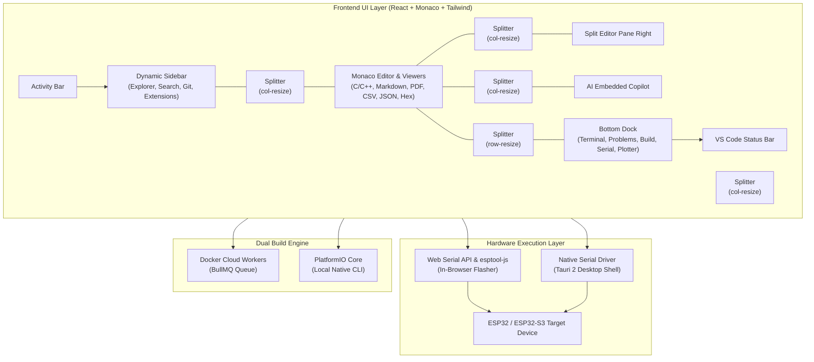

# ESP Studio

> **A Hybrid Embedded Development Platform for ESP32 & ESP32-S3**  
> One codebase, one project format, one user account, two execution environments (Cloud + Local).

---

## 🚀 Overview

ESP Studio is a developer-grade embedded IDE designed to offer a seamless Visual Studio Code-style experience for ESP32 microcontrollers across both modern web browsers (Chrome, Edge via Web Serial & `esptool-js`) and native desktop environments (Windows, macOS, Linux via Tauri 2 & Rust).

Anyone can run ESP Studio as a web application or native desktop software, with full support for **Guest Mode** (no registration needed) or **Cloud-Connected Mode**, complete with an interactive extension ecosystem and a fully responsive layout.

---

## 🛠️ Tech Stack & Programming Languages

ESP Studio is engineered with modern, robust technologies across web, desktop, and embedded hardware layers:

### 1. Programming & Markup Languages
| Language | Version / Target | Responsibility in Project |
| :--- | :--- | :--- |
| **TypeScript** | `v5.4+` | Primary codebase language; type-safe monorepo packages, state management, Monaco editor integration, and protocol models. |
| **Rust** | `2021 Edition` | Tauri 2 native desktop application backend; direct OS-level USB serial communication, filesystem access, and native child processes. |
| **C & C++** | `C++17 / GNU C11` | Embedded firmware projects; Arduino Core for ESP32 and ESP-IDF v5.1 FreeRTOS firmware applications. |
| **JavaScript** | `ES Modules / Node 18+`| Monorepo build tooling, Vite bundling, Monaco AMD loader, icon generation, and packaging scripts. |
| **Assembly (Xtensa LX7)**| `Xtensa ISA` | Low-level dual-core bootloader inspection and hardware disassembly view. |
| **HTML5 & CSS3** | `Tailwind CSS 3.4` | Responsive user interface, hardware-accelerated layouts, and theme design tokens. |
| **Markdown & KaTeX** | `GFM + KaTeX` | Documentation previews, rich README rendering, and embedded math equation rendering. |

### 2. Frontend Framework & Web Technologies
- **React 18.2**: Component-based UI architecture with reactive state hooks (`useState`, `useEffect`, `useRef`).
- **Vite 5.4**: Ultra-fast development server with Hot Module Replacement (HMR) and optimized Rollup production builds.
- **Microsoft Monaco Editor Engine**: The same editing engine that powers Visual Studio Code, providing syntax tokenization, bracket pair colorization, indentation guides, minimap, and error squiggles.
- **Tailwind CSS**: Utility-first responsive CSS styling with custom VS Code dark theme tokens (`github-dark`, `monokai`, `nord`, `vs-dark`).
- **Lucide React**: Modern developer icon suite for activity bars, status bars, and hardware tooling.

### 3. Desktop Application Runtime
- **Tauri 2 (v2.0-rc)**: Secure, memory-efficient desktop shell replacing heavyweight Electron; packages the web frontend with native Rust OS binaries.
- **Serde & Serde JSON**: Zero-copy data serialization between the Rust backend and the React frontend.

### 4. Embedded Hardware & Compilation Toolchains
- **Web Serial API**: Browser-native bidirectional serial communication with ESP32 USB CDC and UART bridges (CP2102, CH340, FTDI) directly from Chrome and Edge without plugins.
- **`esptool-js`**: Pure JavaScript implementation of Espressif's ROM bootloader protocol for client-side USB firmware flashing, partition table verification, and baud switching.
- **PlatformIO Core**: Cross-platform build system for embedded firmware, library dependency resolution, and toolchain management.
- **ESP-IDF v5.1**: Official Espressif IoT Development Framework supporting FreeRTOS dual-core task scheduling, NVS flash encryption, and hardware peripheral drivers.

### 5. State Management & Storage
- **Zustand-Style Reactive Store**: Lightweight event-driven global workspace store with decoupled actions and subscriber listeners (`useWorkspaceStore.ts`).
- **Local-First Storage**: IndexedDB and LocalStorage for zero-latency offline persistence and local-first revision logging.
- **Client-Side PKZIP Engine**: Pure TypeScript binary zip generator (`CRC32`, local file headers, central directory) generating valid `.zip` archives directly in the browser via `Blob` and `URL.createObjectURL`.

### 6. Cloud Infrastructure & Architecture Specifications
- **NestJS & Node.js**: High-performance modular API server for authentication, project syncing, and device fleet provisioning.
- **PostgreSQL**: Relational database storing user accounts, project metadata, and cryptographic device UUIDs.
- **Redis & BullMQ**: Distributed build task queue managing parallel cloud Docker compilation workers.
- **Docker**: Containerized compilation environments running PlatformIO and ESP-IDF toolchains.
- **AWS S3**: Secure object storage for compiled `.bin` firmware artifacts and OTA releases.

---

## 📐 High-Level Architecture



> 📖 **Deep Dive**: See [ARCHITECTURE.md](file:///c:/Users/gilab/OneDrive/Desktop/esp%20studio/ARCHITECTURE.md) for full subsystem documentation, sequence charts, state diagrams, and developer extension recipes.

---

## ✨ Key Features

### 🖥️ Professional VS Code-Style Layout with Stretchable Sections
- **Fully Resizable / Stretchable Panels**:
  - **Sidebar (Left)**: Drag the vertical divider (`cursor-col-resize`) to adjust sidebar width anywhere between `160px` and `700px`. Double-click resets to `260px`.
  - **Bottom Dock (Terminal/Serial/Problems)**: Drag the horizontal divider (`cursor-row-resize`) to adjust panel height between `80px` and full height. Includes a 1-click **Maximize / Restore** button (`Maximize2` / `Minimize2`). Double-click resets to `240px`.
  - **Split Editor (Side-by-Side)**: Click the **Split Editor Right** (`Columns2`) icon to open two files simultaneously. Drag the center divider to adjust screen ratio (`20%` to `80%`). Double-click centers to `50% / 50%`.
  - **AI Copilot (Right)**: Drag the left divider to expand or shrink the AI Assistant panel from `240px` to `700px`. Double-click resets to `360px`.
  - *All panel dimensions automatically persist in `localStorage` across browser refreshes.*
- **Activity Bar & Sidebar**: Switch between File Explorer, Workspace Search & Replace, Source Control (Git), Extensions Sidebar, and Target Device Managers.
- **Monaco Code Editor**: Powered by the same engine as VS Code, with syntax highlighting, token rules, indentation guides, bracket pair colorization, minimap, and error squiggles.
- **Dynamic Multi-Format Viewers**:
  - 📄 **Markdown Viewer**: Live rendered preview with split side-by-side view.
  - 📑 **PDF Viewer**: Embedded datasheet & documentation reader with zoom controls.
  - 📊 **CSV Viewer**: Interactive spreadsheet table with column filters and row numbers.
  - 🌳 **JSON Viewer**: Collapsible interactive tree explorer with formatted raw toggle.
  - 🔬 **Firmware Hex Viewer**: Binary memory inspector with ASCII dump, ESP32 header validation (`0xE9`), and SHA-256 digest calculation.
  - 🖼️ **Image & SVG Viewer**: Asset preview with checkerboard transparency background.

### 📱 Responsive Web & Mobile Design
- **Adaptive Top Navigation**: Gracefully collapses buttons, selectors, and badges across mobile (375px), tablet (768px), laptop (1366px), and 4K ultra-wide screens.
- **Mobile Overflow Menu**: Clean dropdown menu (`MoreVertical` icon) consolidating secondary actions (Export ZIP, Command Palette, Sync Status, Feature Tour, Framework info) on smaller viewports.
- **Touch & Narrow-Screen Friendly**: Clamped sidebar width preventing horizontal page overflow, scrollable bottom dock tabs, and responsive extension detail views.

### 🧩 In-Browser Extensions Ecosystem
- **Dedicated Extensions Sidebar (`ExtensionsSidebar.tsx`)**: Lightweight, compact sidebar listing installed and recommended extensions with quick search, install, disable, and uninstall actions.
- **Full Extensions Marketplace (`ExtensionsMarketplace.tsx`)**: Comprehensive marketplace view with categories (`Language`, `Formatter`, `Embedded Runtime`, `Debugging`), feature breakdowns, starter code templates, and responsive detail inspection.

### 🔌 Dual Mode: Guest Mode & Cloud Mode
- **Guest Mode (No Sign-in Required)**:
  - 100% private, local-first embedded workflow.
  - Edit code, inspect files, flash hardware over Web Serial, and compile locally offline via PlatformIO.
  - 1-click **Export Project ZIP** without server dependencies.
- **Authenticated Cloud Mode**:
  - Remote cloud compilation via containerized Docker workers (600 build minutes/month).
  - AWS S3 firmware artifact storage and SHA-256 binary validation.
  - Fleet device management and bidirectional conflict-free sync (PostgreSQL + SQLite).

### 🛠️ Embedded Hardware & Compilation Tools
- **Dual Execution Engines**: One-click toggle between **Cloud Workers** and **Local PlatformIO Core**.
- **Hardware Flashing**: Direct USB programming via `esptool-js` with real-time sector erase and flash progress.
- **Serial Terminal & Live Waveform Plotter**:
  - High-throughput terminal with timestamping, auto-scroll, and baud rate selection (`9600` to `921600`).
  - Real-time oscilloscope-style graphical plotter for telemetry (heap memory, sensor readings, pressure).

### 🤖 AI Copilot & Version Control
- **AI Embedded Copilot**: Integrated assistance with Claude, Gemini 1.5 Pro, GPT-4o, and DeepSeek for code generation, pinout debugging, and partition calculation.
- **Source Control & Git Graph**: Branch switching, staged/unstaged change tracking, commit author log, and interactive Git history tree.

---

## 🏃 Quick Start: How to Run the Software (Windows, Linux, macOS)

ESP Studio runs natively across **Windows**, **macOS**, and **Linux** with dedicated 1-click launchers for every platform:

### 🪟 Windows Setup
1. **1-Click Batch Launcher**: Simply double-click `start.bat` in File Explorer.
2. **PowerShell Launcher**:
   ```powershell
   .\start.ps1
   ```
3. Automatically verifies Node.js, installs dependencies if needed, and opens **http://localhost:5173** in your default browser.

### 🍎 macOS Setup
1. Open Terminal in the project root:
   ```bash
   chmod +x start.sh scripts/*.sh
   ./start.sh
   ```
2. Automatically launches the IDE in Chrome, Edge, or Safari at **http://localhost:5173**.
3. Keyboard shortcuts automatically map to Mac keys (e.g. `⌘B` to Build, `⌘U` to Flash, `⌘K` for Command Palette).

### 🐧 Linux Setup (Ubuntu, Debian, Fedora, Arch)
1. Ensure your user has access to USB serial ports (dialout / uucp group):
   ```bash
   # Add your user to dialout group for Web Serial USB permissions
   sudo usermod -a -G dialout $USER
   # (Log out and log back in for group changes to take effect)
   ```
2. Run the shell launcher:
   ```bash
   chmod +x start.sh scripts/*.sh
   ./start.sh
   ```

---

### 💻 Standard Cross-Platform Terminal Commands
Works identically across Windows, macOS, and Linux:
```bash
# 1. Install workspace dependencies
npm install

# 2. Start the web IDE (opens http://localhost:5173)
npm run dev

# 3. Full monorepo typecheck & build verification
npm run build

# 4. Generate clean project ZIP archive
npm run package:zip
```

---

### 🖥️ Native Desktop Application Builders (Tauri 2)

Compile native desktop binaries for your operating system:

- **Windows**:
  ```powershell
  powershell -ExecutionPolicy Bypass -File .\scripts\build-desktop.ps1
  # Generates .msi installer and .exe executable in apps/desktop/src-tauri/target/release/
  ```
- **macOS & Linux**:
  ```bash
  chmod +x ./scripts/build-desktop.sh
  ./scripts/build-desktop.sh
  # macOS: Generates .dmg installer and .app bundle
  # Linux: Generates .deb package and .AppImage
  ```

---

## 📦 Exporting Projects as ZIP

Users can export their entire project workspace into a clean, standard `.zip` archive at any time:
1. Click the **Export ZIP** button in the top navigation header, or
2. Click the **Download** icon in the File Explorer sidebar, or
3. Run `npm run package:zip` from the terminal to create the distribution package:
```
esp-studio-starter.zip (260 KB)
```

---

## 📁 Repository Structure

```
esp-studio/
├── apps/
│   ├── web/               # React + TypeScript + Monaco + Tailwind Web IDE
│   └── desktop/           # Tauri 2 (Rust) Desktop Application Shell
├── packages/
│   ├── shared-types/      # Core data models, device schemas, and configuration types
│   ├── protocol/          # API, WebSocket, and serial frame contracts
│   ├── project-core/      # Project file management, templates, and validation
│   ├── device-core/       # Hardware abstraction, UUID provisioning, and NVS specs
│   ├── serial-core/       # Abstract SerialProvider (Web Serial & Desktop Native)
│   ├── build-core/        # Abstract BuildProvider & build artifact schemas
│   ├── flash-core/        # Abstract FlashProvider & esptool-js integration
│   ├── sync-core/         # Local-first sync engine & 3-way conflict resolver
│   ├── editor/            # Monaco editor integration & C/C++ syntax presets
│   └── ui/                # Shared design system components & dark theme tokens
├── templates/
│   ├── esp32s3-arduino/   # Starter ESP32-S3 Arduino template
│   └── esp32s3-esp-idf/   # Starter ESP32-S3 ESP-IDF template
├── docs/                  # Architecture specifications (10 detailed engineering docs)
├── scripts/
│   ├── build-all.js       # Cross-platform full build script
│   ├── build-all.ps1      # Windows PowerShell full build script
│   ├── build-all.sh       # Linux / macOS full build script
│   ├── build-desktop.ps1  # Windows Tauri 2 desktop app builder
│   ├── build-desktop.sh   # Linux / macOS Tauri 2 desktop app builder
│   ├── generate-icons.js  # Cross-platform app icons generator
│   ├── package-zip.js     # Cross-platform PKZIP starter packager (Node.js)
│   └── package-zip.ps1    # PowerShell starter project packager
├── start.bat              # Double-click Windows launcher
├── start.ps1              # PowerShell quick launcher (Windows/Linux/macOS)
├── start.sh               # Bash quick launcher (Linux & macOS)
├── ARCHITECTURE.md        # Comprehensive architecture and developer guide
└── esp-studio-starter.zip # Downloadable starter project archive
```

---

## 📚 Technical Documentation

Detailed architecture specifications are located in [`docs/`](file:///c:/Users/gilab/OneDrive/Desktop/esp%20studio/docs):
- [Architecture & Developer Guide](file:///c:/Users/gilab/OneDrive/Desktop/esp%20studio/ARCHITECTURE.md)
- [Product Requirements](file:///c:/Users/gilab/OneDrive/Desktop/esp%20studio/docs/PRODUCT_REQUIREMENTS.md)
- [System Architecture](file:///c:/Users/gilab/OneDrive/Desktop/esp%20studio/docs/SYSTEM_ARCHITECTURE.md)
- [Build System & Workers](file:///c:/Users/gilab/OneDrive/Desktop/esp%20studio/docs/BUILD_SYSTEM.md)
- [Device Communication Protocol](file:///c:/Users/gilab/OneDrive/Desktop/esp%20studio/docs/DEVICE_PROTOCOL.md)
- [Synchronization Protocol](file:///c:/Users/gilab/OneDrive/Desktop/esp%20studio/docs/SYNC_PROTOCOL.md)
- [Database Schema](file:///c:/Users/gilab/OneDrive/Desktop/esp%20studio/docs/DATABASE_SCHEMA.md)
- [Security Design](file:///c:/Users/gilab/OneDrive/Desktop/esp%20studio/docs/SECURITY_DESIGN.md)
- [API Specification](file:///c:/Users/gilab/OneDrive/Desktop/esp%20studio/docs/API_SPECIFICATION.md)
- [Testing Strategy](file:///c:/Users/gilab/OneDrive/Desktop/esp%20studio/docs/TESTING_STRATEGY.md)
- [Development Roadmap](file:///c:/Users/gilab/OneDrive/Desktop/esp%20studio/docs/DEVELOPMENT_ROADMAP.md)
