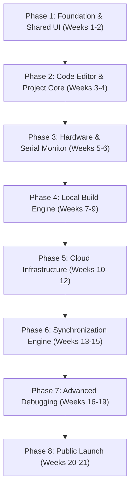

# ESP Studio — Development Roadmap

**Document Version:** 1.0.0  
**Overall Estimate:** 12–21 weeks across 8 phased milestones

---

## Roadmap Phases

### Phase 1: Foundation and Shared UI (Current Milestone)
- Monorepo structure with shared packages.
- React + TypeScript web workspace (`apps/web`).
- Tauri desktop shell structure (`apps/desktop`).
- Shared project and device interfaces.
- Engineering specifications for build, sync, hardware, and security.
- Initial ESP Studio workspace UI concept (dark/light theme, workspace tabs, toolbar, mock terminal).

### Phase 2: Code Editor & Project Management
- Full Monaco Editor integration with C/C++ syntax highlighting.
- Virtualized file explorer with create/delete/rename operations.
- Project templates for ESP32-S3 Arduino and ESP-IDF.
- Local persistence via IndexedDB (Web) and SQLite (Desktop).

### Phase 3: Hardware Communication
- ESP32-S3 USB detection and Web Serial integration.
- `esptool-js` browser flasher integration.
- Live serial monitor with timestamping, ANSI colors, and baud rate negotiation.
- Custom device ID provisioning (`SPRAYER-001`).

### Phase 4: Local Build Engine
- Local PlatformIO toolchain integration for Tauri desktop.
- Live build log parsing with Monaco diagnostic squiggles.
- Deterministic firmware artifact packaging (`build-output/`).

### Phase 5: Cloud Infrastructure
- NestJS API backend + PostgreSQL schema deployment.
- Redis + BullMQ job queues for cloud builds.
- Isolated Docker compilation workers.
- AWS S3 artifact upload and signed download URLs.

### Phase 6: Synchronization Engine
- Local-first transactional outbox.
- SHA-256 file hashing and change detection.
- 3-way merge UI for resolving conflicting edits.

### Phase 7: Advanced Debugging
- Real-time serial graphing / oscilloscope view.
- CAN bus analyzer module.
- MQTT monitor and telemetry dashboards.
- FreeRTOS task and heap visualizer.

### Phase 8: Public Launch & Distribution
- Tauri signed desktop installers (Windows `.msi`/`.exe`, macOS `.dmg`, Linux `.AppImage`).
- Hosted Web IDE on CloudFront + S3.
- End-to-end integration verification and public documentation.
