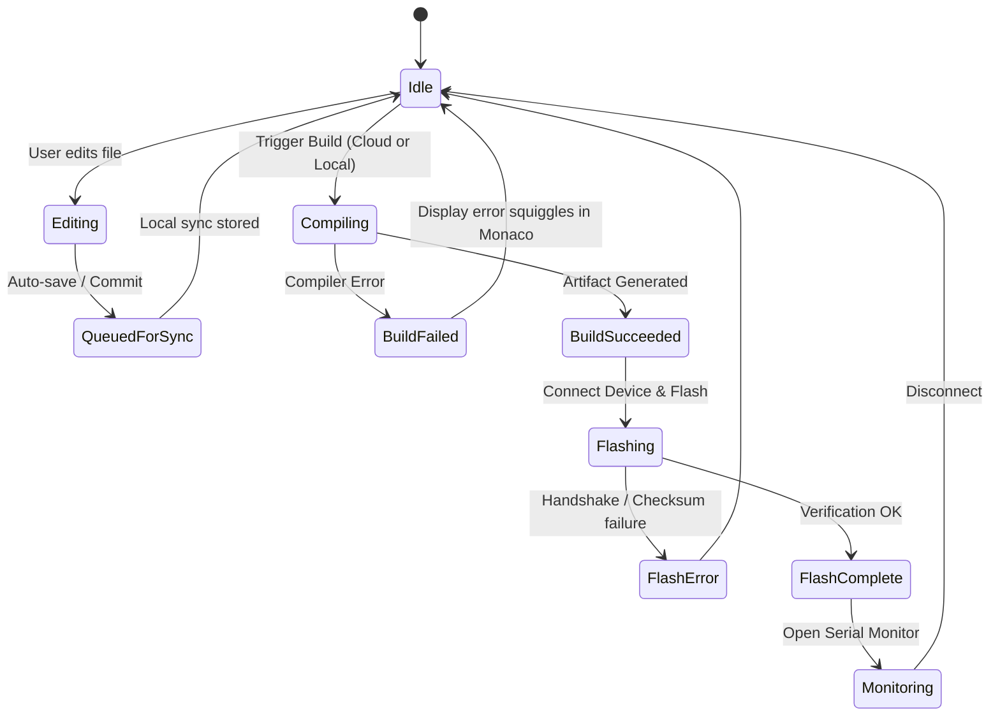

# ESP Studio — System Architecture

**Document Version:** 1.0.0  
**Status:** Approved  
**Pattern:** Hexagonal / Ports-and-Adapters with Monorepo Package Boundary

---

## 1. System Topology Overview

ESP Studio is architected around an inversion-of-control model where the core user interface and business logic never communicate directly with platform-specific hardware APIs or operating system kernels. Instead, all external capabilities are accessed via strictly typed Provider Interfaces.

```
                           +----------------------------------------+
                           |          ESP Studio Frontend           |
                           |   (React 18 + TypeScript + Zustand)    |
                           +----------------------------------------+
                                  |                     |
         [Web Platform Layer]     |                     |    [Desktop Platform Layer]
                                  v                     v
                 +-----------------------+       +-----------------------+
                 |  Web Serial / USB     |       |   Tauri 2 IPC Core    |
                 |  esptool-js (WebASM)  |       |   Rust Hardware Bridge|
                 |  IndexedDB Storage    |       |   SQLite / Local FS   |
                 +-----------------------+       +-----------------------+
                                  |                          |
                                  | HTTP / WebSocket         | Local Child Process
                                  v                          v
                 +-----------------------+       +-----------------------+
                 |   Cloud Backend API   |       | Local PlatformIO Core |
                 | (NestJS + PostgreSQL) |       | (Python / GCC Toolchain|
                 +-----------------------+       +-----------------------+
                                  |
                                  v
                 +-----------------------+
                 |  Docker Build Workers |
                 |  (BullMQ + Redis + S3)|
                 +-----------------------+
```

---

## 2. Core Package Boundaries

```
@esp-studio/shared-types   <-- Foundational data models (Project, Device, Build, Sync)
@esp-studio/protocol       <-- Network protocols, WebSocket frames, RPC wire definitions
@esp-studio/project-core   <-- File system representations, project templates, validation
@esp-studio/device-core    <-- Device discovery, NVS provisioning schemas, serial IDs
@esp-studio/serial-core    <-- Abstract SerialProvider + Web / Desktop adapters
@esp-studio/build-core     <-- Abstract BuildProvider + artifact verification
@esp-studio/flash-core     <-- Abstract FlashProvider + esptool-js binding
@esp-studio/sync-core      <-- Offline transactional outbox + 3-way conflict resolver
@esp-studio/ui             <-- Design system tokens, buttons, modal dialogs, layout primitives
@esp-studio/editor         <-- Monaco editor wrapper, LSP diagnostics hooks, C/C++ presets
```

---

## 3. Provider Interfaces & Abstraction Layer

The core architectural invariant is that frontend views depend only on abstract providers:

### 3.1 BuildProvider
```typescript
export interface BuildProvider {
  build(project: Project, options?: BuildOptions): Promise<BuildResult>;
  cancelBuild(jobId: string): Promise<void>;
  streamLogs(jobId: string, onLine: (line: string) => void): () => void;
}
```
- **Implementations:**
  - `CloudBuildProvider`: Submits project bundle to `POST /api/v1/builds`, polls or connects via WebSocket for compilation output, downloads `FirmwareArtifact`.
  - `LocalBuildProvider`: Invocates local `platformio run` via Tauri Rust command or child process, pipes stdout directly to state store.

### 3.2 SerialProvider
```typescript
export interface SerialProvider {
  listPorts(): Promise<SerialPortInfo[]>;
  connect(portId: string, options: SerialOptions): Promise<void>;
  disconnect(): Promise<void>;
  write(data: Uint8Array | string): Promise<void>;
  onData(handler: (chunk: Uint8Array) => void): () => void;
  onError(handler: (err: Error) => void): () => void;
}
```
- **Implementations:**
  - `BrowserSerialProvider`: Uses browser `navigator.serial.requestPort()` and `ReadableStreamDefaultReader`.
  - `DesktopSerialProvider`: Invokes Tauri Rust `serialport-rs` crate for native OS COM port communication.

### 3.3 FlashProvider
```typescript
export interface FlashProvider {
  flash(artifact: FirmwareArtifact, options: FlashOptions): Promise<FlashResult>;
  eraseFlash(options: FlashOptions): Promise<void>;
  onProgress(handler: (progress: FlashProgress) => void): () => void;
}
```
- **Implementations:**
  - `BrowserFlashProvider`: Integrates `esptool-js` with Web Serial transport.
  - `DesktopFlashProvider`: Invokes native bundled `esptool` executable or native Rust flashing crate.

### 3.4 SyncProvider
```typescript
export interface SyncProvider {
  sync(projectId: string): Promise<SyncResult>;
  getPendingChanges(projectId: string): Promise<ChangeRecord[]>;
  resolveConflict(conflictId: string, resolution: ConflictResolution): Promise<void>;
}
```

---

## 4. Execution State Machine


